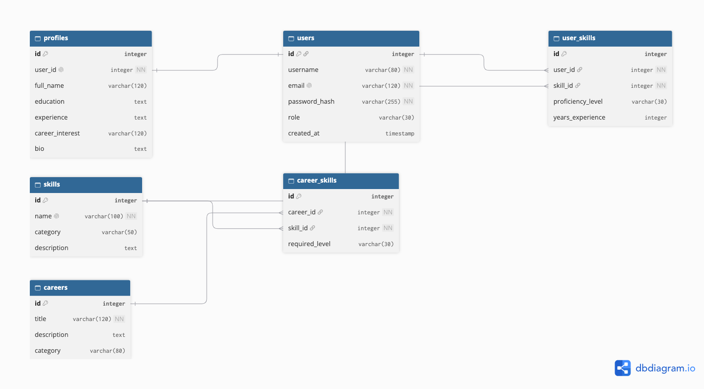

Interactive version: [View on dbdiagram.io](https://dbdiagram.io/d/6af42ed804c7e97b1d2f9f09)

# CtrlYourCareer – Student MVP Database Design

## 1. Project Overview

CtrlYourCareer is a student-focused skills assessment and career development platform.

The database stores student accounts, academic profiles, skills, career interests, assessments, assessment results, career recommendations and learning progress.

The first release will focus on students. The design will allow additional user profile types to be introduced when the platform expands to job seekers and working professionals.

## 2. Database Technology

- Database: PostgreSQL
- Backend: Python with Flask
- ORM: SQLAlchemy
- Testing: Pytest

## 3. Database Entities and Attributes

### 3.1 users

Stores account and authentication information.

| Attribute | Data type | Key | Constraint |
|---|---|---|---|
| user_id | INTEGER | PK | Auto-generated |
| full_name | VARCHAR(100) | | NOT NULL |
| email | VARCHAR(150) | | UNIQUE, NOT NULL |
| password_hash | VARCHAR(255) | | NOT NULL |
| role | VARCHAR(30) | | NOT NULL |
| created_at | TIMESTAMP | | NOT NULL |

### 3.2 student_profiles

Stores additional academic information about each student.

| Attribute | Data type | Key | Constraint |
|---|---|---|---|
| profile_id | INTEGER | PK | Auto-generated |
| user_id | INTEGER | FK | UNIQUE, NOT NULL |
| institution | VARCHAR(150) | | |
| course | VARCHAR(150) | | |
| education_level | VARCHAR(100) | | |
| graduation_year | INTEGER | | |
| bio | TEXT | | |

`user_id` references `users.user_id`.

### 3.3 sectors

Stores career industries.

| Attribute | Data type | Key | Constraint |
|---|---|---|---|
| sector_id | INTEGER | PK | Auto-generated |
| sector_name | VARCHAR(100) | | UNIQUE, NOT NULL |
| description | TEXT | | |

Examples: Technology, Business and Finance, Agriculture, Marketing and Communication.

### 3.4 careers

Stores career paths available on the platform.

| Attribute | Data type | Key | Constraint |
|---|---|---|---|
| career_id | INTEGER | PK | Auto-generated |
| sector_id | INTEGER | FK | NOT NULL |
| career_name | VARCHAR(150) | | NOT NULL |
| description | TEXT | | |
| education_requirements | TEXT | | |

`sector_id` references `sectors.sector_id`.

### 3.5 skills

Stores skills that can be assessed or recommended.

| Attribute | Data type | Key | Constraint |
|---|---|---|---|
| skill_id | INTEGER | PK | Auto-generated |
| skill_name | VARCHAR(100) | | UNIQUE, NOT NULL |
| category | VARCHAR(100) | | |
| description | TEXT | | |

### 3.6 student_career_interests

Connects students with the careers they are interested in.

| Attribute | Data type | Key | Constraint |
|---|---|---|---|
| interest_id | INTEGER | PK | Auto-generated |
| user_id | INTEGER | FK | NOT NULL |
| career_id | INTEGER | FK | NOT NULL |
| created_at | TIMESTAMP | | NOT NULL |

Foreign keys:
- `user_id` references `users.user_id`.
- `career_id` references `careers.career_id`.

Unique constraint: `(user_id, career_id)`.

### 3.7 student_skills

Stores the current recorded proficiency of each student's skills.

| Attribute | Data type | Key | Constraint |
|---|---|---|---|
| student_skill_id | INTEGER | PK | Auto-generated |
| user_id | INTEGER | FK | NOT NULL |
| skill_id | INTEGER | FK | NOT NULL |
| proficiency_level | VARCHAR(30) | | NOT NULL |
| source_type | VARCHAR(30) | | NOT NULL |
| updated_at | TIMESTAMP | | NOT NULL |

Foreign keys:
- `user_id` references `users.user_id`.
- `skill_id` references `skills.skill_id`.

Unique constraint: `(user_id, skill_id)`.

`source_type` identifies whether a skill was self-declared or assessed.

### 3.8 career_skills

Connects careers to the skills required for those careers.

| Attribute | Data type | Key | Constraint |
|---|---|---|---|
| career_skill_id | INTEGER | PK | Auto-generated |
| career_id | INTEGER | FK | NOT NULL |
| skill_id | INTEGER | FK | NOT NULL |
| importance_weight | NUMERIC(5,2) | | NOT NULL |
| required_level | VARCHAR(30) | | NOT NULL |

Foreign keys:
- `career_id` references `careers.career_id`.
- `skill_id` references `skills.skill_id`.

Unique constraint: `(career_id, skill_id)`.

`importance_weight` should be greater than zero. The team should agree on the weight scale used by the recommendation algorithm.

### 3.9 assessments

Stores assessments available to students.

| Attribute | Data type | Key | Constraint |
|---|---|---|---|
| assessment_id | INTEGER | PK | Auto-generated |
| title | VARCHAR(150) | | NOT NULL |
| description | TEXT | | |
| assessment_type | VARCHAR(50) | | NOT NULL |
| time_limit | INTEGER | | |

### 3.10 assessment_skills

Connects assessments to the skills they measure.

| Attribute | Data type | Key | Constraint |
|---|---|---|---|
| assessment_skill_id | INTEGER | PK | Auto-generated |
| assessment_id | INTEGER | FK | NOT NULL |
| skill_id | INTEGER | FK | NOT NULL |

Foreign keys:
- `assessment_id` references `assessments.assessment_id`.
- `skill_id` references `skills.skill_id`.

Unique constraint: `(assessment_id, skill_id)`.

### 3.11 questions

Stores questions belonging to an assessment.

| Attribute | Data type | Key | Constraint |
|---|---|---|---|
| question_id | INTEGER | PK | Auto-generated |
| assessment_id | INTEGER | FK | NOT NULL |
| question_text | TEXT | | NOT NULL |
| question_type | VARCHAR(30) | | NOT NULL |
| marks | NUMERIC(5,2) | | NOT NULL |

`assessment_id` references `assessments.assessment_id`.

### 3.12 question_options

Stores multiple-choice options for questions.

| Attribute | Data type | Key | Constraint |
|---|---|---|---|
| option_id | INTEGER | PK | Auto-generated |
| question_id | INTEGER | FK | NOT NULL |
| option_text | TEXT | | NOT NULL |
| is_correct | BOOLEAN | | NOT NULL |

`question_id` references `questions.question_id`.

The backend must not expose `is_correct` to students before submission.

### 3.13 assessment_attempts

Records each student's assessment attempt.

| Attribute | Data type | Key | Constraint |
|---|---|---|---|
| attempt_id | INTEGER | PK | Auto-generated |
| user_id | INTEGER | FK | NOT NULL |
| assessment_id | INTEGER | FK | NOT NULL |
| started_at | TIMESTAMP | | NOT NULL |
| completed_at | TIMESTAMP | | |
| total_score | NUMERIC(6,2) | | |
| status | VARCHAR(30) | | NOT NULL |

Foreign keys:
- `user_id` references `users.user_id`.
- `assessment_id` references `assessments.assessment_id`.

### 3.14 assessment_answers

Stores answers submitted during an assessment attempt.

| Attribute | Data type | Key | Constraint |
|---|---|---|---|
| answer_id | INTEGER | PK | Auto-generated |
| attempt_id | INTEGER | FK | NOT NULL |
| question_id | INTEGER | FK | NOT NULL |
| selected_option_id | INTEGER | FK | |
| answer_text | TEXT | | |
| awarded_marks | NUMERIC(5,2) | | |

Foreign keys:
- `attempt_id` references `assessment_attempts.attempt_id`.
- `question_id` references `questions.question_id`.
- `selected_option_id` references `question_options.option_id`.

Unique constraint: `(attempt_id, question_id)`.

The selected option must belong to the question being answered. This should be validated by the backend or an appropriate database constraint.

### 3.15 learning_resources

Stores learning materials available to students.

| Attribute | Data type | Key | Constraint |
|---|---|---|---|
| resource_id | INTEGER | PK | Auto-generated |
| title | VARCHAR(200) | | NOT NULL |
| description | TEXT | | |
| resource_url | TEXT | | |
| resource_type | VARCHAR(50) | | |

### 3.16 resource_skills

Connects learning resources to the skills they develop.

| Attribute | Data type | Key | Constraint |
|---|---|---|---|
| resource_skill_id | INTEGER | PK | Auto-generated |
| resource_id | INTEGER | FK | NOT NULL |
| skill_id | INTEGER | FK | NOT NULL |

Foreign keys:
- `resource_id` references `learning_resources.resource_id`.
- `skill_id` references `skills.skill_id`.

Unique constraint: `(resource_id, skill_id)`.

### 3.17 learning_progress

Tracks student progress through learning resources.

| Attribute | Data type | Key | Constraint |
|---|---|---|---|
| progress_id | INTEGER | PK | Auto-generated |
| user_id | INTEGER | FK | NOT NULL |
| resource_id | INTEGER | FK | NOT NULL |
| status | VARCHAR(30) | | NOT NULL |
| started_at | TIMESTAMP | | |
| completed_at | TIMESTAMP | | |

Foreign keys:
- `user_id` references `users.user_id`.
- `resource_id` references `learning_resources.resource_id`.

Unique constraint: `(user_id, resource_id)` for one current progress record per student and resource.

### 3.18 career_matches

Stores career recommendations generated for students.

| Attribute | Data type | Key | Constraint |
|---|---|---|---|
| match_id | INTEGER | PK | Auto-generated |
| user_id | INTEGER | FK | NOT NULL |
| career_id | INTEGER | FK | NOT NULL |
| compatibility_score | NUMERIC(5,2) | | NOT NULL |
| generated_at | TIMESTAMP | | NOT NULL |

Foreign keys:
- `user_id` references `users.user_id`.
- `career_id` references `careers.career_id`.

Compatibility scores must be between 0 and 100.

## 4. Main Database Relationships

- One user has one student profile.
- One user can have many career interests.
- One user can have many recorded skills.
- One career belongs to one sector.
- One career can require many skills.
- One skill can be required by many careers.
- One assessment can measure many skills.
- One skill can be measured by many assessments.
- One assessment contains many questions.
- One question can have many answer options.
- One user can make many assessment attempts.
- One assessment can have many attempts.
- One attempt can contain many answers.
- One learning resource can develop many skills.
- One skill can be developed by many learning resources.
- One user can track progress on many learning resources.
- One user can receive many career matches.

## 5. Database Design Rules

1. Every entity must have a primary key.
2. Foreign keys must reference existing records.
3. Email addresses must be unique.
4. Linking tables must prevent duplicate relationships.
5. Passwords must be stored as secure hashes, never plain text.
6. Compatibility scores must be between 0 and 100.
7. Assessment answer keys must not be exposed to students.
8. Timestamps should be stored consistently, preferably in UTC.
9. Deletion rules for related records must be agreed upon before implementation.
10. Database migrations should be used to manage schema changes.
